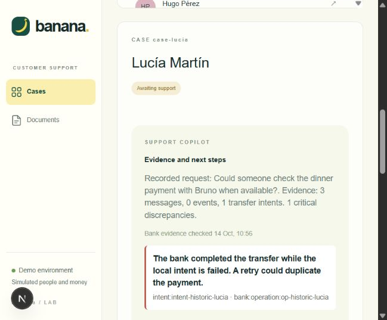
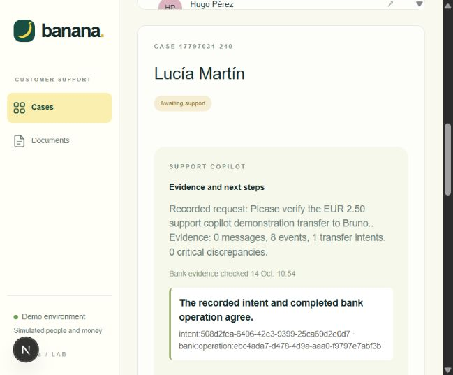

Desarrollo y entrega de Banana Bank

Maximo Porretti  |  14 de octubre de 2026

Implementé un flujo de desarrollo con agentes para abordar las dos partes del challenge: transferencias confiables y un asistente de soporte que reconstruye cada caso a partir de evidencia. El proyecto incluye código, pruebas, capturas y las sesiones originales de IA.

## Mi participación y el uso de IA

Definí la necesidad de crear los .agents, el alcance del flujo desde el requerimiento hasta la entrega y la elección del asistente de soporte con evidencia. Codex redactó los archivos e implementó y verificó los cambios bajo mis instrucciones. Esta entrega identifica esa asistencia y conserva los registros originales; no atribuye a trabajo manual los archivos generados por IA.

## Resultado y alcance

La reproducción del código original mostró un débito sin confirmación y un pago duplicado tras perderse la respuesta. La versión corregida exige una propuesta explícita y conserva una referencia bancaria por intención. Las 29 pruebas pasan. También se verificaron tipos, una compilación de producción y los flujos de navegador.

El copilot funciona con evidencia estructurada sin una clave de OpenAI. La generación opcional de un resumen con el modelo quedó pendiente de validación real por no contar con una clave configurada. El simulador bancario se conservó como dependencia externa.

## Cómo recorrer esta entrega

El documento explica el flujo, las decisiones, los resultados antes y después, la función nueva y los pasos de reproducción. submission/ contiene las capturas, evidencia JSON, sesiones originales y un borrador de correo con mi nombre completo en el asunto.

---

# Flujo desde el requerimiento hasta la entrega

AGENTS.md es el punto de entrada del proyecto. Deriva al flujo reutilizable .agents/skills/feature-delivery/SKILL.md. Los archivos de .agents/roles/ son instrucciones para asignar trabajo; no son agentes registrados automáticamente en la aplicación.

Etapa y rol | Entrada | Salida y criterio de avance

Requerimientos | Challenge y contrato | Alcance y criterios en submission/requirements.md

Arquitectura | Criterios aceptados | Estados, límites del banco y archivos asignados

Implementación bancaria | Diseño de pagos | Propuestas, referencias estables y pruebas HTTP

Desarrollo del agente | Casos y evidencia | Copilot, trazabilidad y fuentes aplicables

QA y revisión | Cambios ejecutables | Pruebas, tipos, build, UI y revisión independiente

Entrega | Resultados verificados | PDF, sesiones, manifiesto y ZIP reproducible

## Justificación estratégica ante la restricción de tiempo

La adopción de este flujo de agentes modulares y asistidos por IA fue una decisión estratégica motivada por la optimización del tiempo disponible. Ante la envergadura del challenge (reparar la integridad financiera, diseñar un Copilot de soporte con evidencia y documentar rigurosamente los resultados) dentro de un plazo acotado de entrega, un enfoque manual tradicional habría obligado a sacrificar profundidad en las pruebas o alcance en la funcionalidad. Estructurar el trabajo en roles especializados (.agents/roles/) permitió maximizar la velocidad de ejecución: concentró la atención humana de Maximo Porretti en las decisiones arquitectónicas críticas (inmutabilidad, idempotencia atómica y seguridad), mientras la IA aceleró la implementación técnica, la suite de pruebas y la trazabilidad auditable.

## Cómo usamos el flujo en este challenge

El coordinador leyó los requerimientos, fijó criterios y dividió los archivos. El agente banking implementó el flujo financiero; agent_support trabajó en soporte, documentación y luego empaquetado. reviewer revisó de forma independiente y reprodujo los fallos originales. El coordinador integró API e interfaz y preparó la demostración y el documento.

Los roles de requisitos, arquitectura y QA se ejecutaron desde la sesión coordinadora. La delegación real y sus resultados están en los JSONL originales. Los cambios de dirección y verificaciones se registran en submission/workflow-log.md.

## Aplicarlo a la próxima feature

Abrir una sesión en la raíz del proyecto y pedir: “Usá feature-delivery para implementar [requerimiento] con estos criterios de aceptación”. El agente debe leer AGENTS.md, definir alcance, diseñar, implementar, verificar, revisar y preparar la entrega. Un destino remoto se configura cuando corresponde; no se declara una publicación que no se realizó.

---

# Parte uno transferencias confiables

Priorizamos confirmación y reintentos porque un error puede mover dinero sin una revisión explícita o repetir un pago. La comparación usa el starter original, bancos y bases temporales y escenarios reproducibles. No se cambió el comportamiento del banco para obtener resultados favorables.

Escenario | Original observado | Versión corregida

Solicitud de EUR 10 sin confirmar | completed; débito EUR 10; 1 operación | requires_confirmation; EUR 0; 0 operaciones

Confirmación explícita | No requerida en starter | Débito EUR 10; 1 operación

Respuesta perdida al enviar EUR 10 | Débito EUR 20; 2 operaciones; 2 referencias | Débito EUR 10; 1 operación; 1 referencia

## Decisiones de implementación

Cada propuesta dura diez minutos y queda vinculada a usuario, intención y payload inmutable. Solo la sesión de su titular puede confirmarla. La confirmación consume la aprobación y persiste una referencia bancaria de forma atómica. Las solicitudes simultáneas y los reintentos posteriores al reinicio reutilizan esa referencia.

Un timeout no se interpreta como rechazo. La integración consulta GET /v1/operations/:reference. Si el resultado sigue sin verificarse, conserva unknown. El dashboard muestra la transferencia pendiente y permite consultar la intención original después de recargar.

## Cambios y evidencia

Archivos principales: src/banking/actions.ts, authorization.ts y dispatch.ts; app/api/[...path]/route.ts y app/page.tsx. Pruebas: tests/banking.test.ts. La comparación original está en submission/before-after.json; scripts/reproduce-baseline.ts conserva el procedimiento.

## Revisión que cambió el resultado

La revisión encontró que una aprobación consumida desaparecía aunque el resultado fuera desconocido. Se agregó pendingTransfers y una prueba de recarga y consulta con la aprobación original: el banco conserva un único efecto. También se hicieron visibles los identificadores que permiten resolver las citas del copilot.

---

# Demostración de confirmación

En la interfaz de Lucía creamos una transferencia nueva de EUR 12,34 hacia Bruno. La aplicación mostró una propuesta con importe, origen, destino y descripción. Tras pulsar Confirm these details, verificamos el aviso de finalización y el saldo actualizado.

Detalle ampliado de la captura real de la propuesta pendiente. El botón inicial fue renombrado luego a Review transfer para describir mejor su efecto. La captura original completa está en submission/screenshots/transfer-proposal.png.

Comprobación automatizada complementaria: una propuesta no modifica el saldo; las confirmaciones simultáneas y la repetición tras reiniciar la conexión local devuelven una única operación.

---

# Parte dos asistente de soporte con evidencia

La función nueva ayuda al operador a decidir el próximo paso sin reconstruir acciones que nunca fueron registradas. Combina mensajes, eventos de herramientas, intenciones y una consulta autenticada de solo lectura al banco. Presenta discrepancias, fuentes identificables, vacíos históricos y un borrador de respuesta.

Caso histórico de Lucía. El banco muestra el pago completado aunque la intención local esté marcada failed. El copilot recomienda reconciliar la referencia original y evitar un pago nuevo. Los eventos históricos faltantes se reconocen como evidencia ausente.

## Valor y límites del asistente

El análisis estructurado está integrado en el flujo del agente y soporte y funciona sin clave. Prepare operator briefing ofrece un resumen de IA cuando hay una clave, manteniendo la evidencia a disposición del operador. El texto generado se presenta como borrador; no ejecuta pagos ni autoriza transferencias.

Archivos: src/operator/view.ts y copilot.ts, src/telemetry.ts y la ruta /api/incidents/:id/briefing. La interfaz muestra las citas, los eventos y las intenciones. Los clientes no pueden acceder al detalle de los operadores.

---

# Caso nuevo y calidad de las fuentes

Creamos una conversación nueva por la API pública, propusimos y confirmamos EUR 2,50 y solicitamos soporte mediante request_human. El caso conserva ocho eventos, una intención y una operación bancaria coincidente. Esta demostración usa las herramientas HTTP; no pretende representar una conversación generada por el modelo.

Captura real del caso nuevo con el hallazgo transfer_verified. submission/demo-evidence.json conserva los identificadores y el resultado. La ausencia de mensajes en esta demostración se muestra como un vacío de evidencia.

## Información documental más confiable

Los fragmentos conservan título, versión, vigencia y audiencia. La búsqueda filtra por la fecha de referencia del ejercicio, 24 de septiembre de 2026, y por el rol. El índice incluido se adapta desde el manifest sin regenerar embeddings. El prompt exige citas y reconocer la información faltante, en vez de completar condiciones con estimaciones bancarias.

Se probaron la conservación de metadatos, la exclusión de documentos obsoletos y fuentes internas para clientes, y los casos de falta de evidencia. No se ejecutaron llamadas reales de embeddings o generación con OpenAI.

---

# Verificación y pasos para probar

Verificación | Resultado

Pruebas públicas | 13 de 13 aprobadas

Integración bancaria HTTP | 9 de 9 aprobadas

Soporte y fuentes | 7 de 7 aprobadas

npm run typecheck | Aprobado

npm run build | Compilación de producción aprobada

Navegador y API pública | Propuesta, confirmación, caso histórico y caso nuevo verificados

Revisión independiente | Hallazgos corregidos; sin bloqueos adicionales en el alcance

## Instalación y ejecución

Node 24 o superior. En este equipo Windows se usó Node 24.19.0. npm ci activó el fallo de compilación de SQLite documentado por el starter; npm ci --ignore-scripts funcionó con el binario nativo incluido. La carga de SQLite se comprobó antes de continuar.

npm ci --ignore-scripts
npm run setup
npm test
npm run typecheck
npm run dev

Abrir http://127.0.0.1:3000. Seleccionar Lucía para crear una propuesta y confirmarla. Seleccionar Marta y abrir el caso del pago de la cena para ver la discrepancia histórica. Con los servicios activos, node scripts/demo-support.mjs crea un caso nuevo. Cada ejecución de ese script representa una nueva intención simulada.

## Escenarios de errores

npm run scenario -- lost-response y npm run scenario -- read-unavailable permiten probar respuestas perdidas y reconciliación no disponible. Volver a normal para una línea de base. Las pruebas usan bases y puertos temporales; no requieren una clave y no alteran la actividad de la aplicación abierta.

---

# Entrega reproducible y pendientes

## Sesiones originales y archivos

submission/ai-sessions/ contiene los JSONL originales de la sesión coordinadora y los agentes banking, agent_support y reviewer. manifest.json identifica cada sesión y su SHA256. No se reemplazan por este resumen. Los guardian internos de permisos se omiten y esa exclusión se declara en el manifiesto.

El ZIP contiene el código completo, .agents, AGENTS.md, las fixtures, templates de configuración, pruebas, PDF, capturas, evidencia JSON y las sesiones originales. Excluye node_modules, .next, .data, archivos .env con configuración local, Git y temporales.

## Actualizar y empaquetar

npm run sessions:export
npm run package:submission

El resultado se crea fuera de la raíz del código, en delivery/banana-bank-maximo-porretti.zip cuando se usa esta estructura de carpetas. El empaquetador conserva los archivos ocultos del flujo y genera un manifiesto de integridad. Revisar el ZIP en una carpeta nueva y ejecutar setup y las verificaciones.

La sesión activa puede crecer después de exportarla. Ejecutar ambos comandos al terminar esta conversación y antes de enviar para incorporar también el cierre y cualquier interacción posterior.

## Asunto y canal

Asunto: Maximo Porretti - Banana Bank Technical Challenge. submission/email-draft.txt prepara el correo para hr@tdots.es según el starter. El repositorio provisto sirve de referencia del challenge; esta ejecución prepara un ZIP local y no realizó push ni envío de correo.

## Límites y trabajo pendiente

Sin clave de OpenAI, no se validó generación real del chat, embeddings ni el briefing opcional con el proveedor. No se pretende certificar un lanzamiento completo: se priorizaron los fallos financieros y la evidencia de soporte. npm audit reportó avisos altos en next, sharp y source-map-js; revisar y actualizar esas dependencias antes de exposición pública. La selección de personas sigue siendo una conveniencia de simulación, no autenticación de producción.

La publicación remota o el envío se realiza sobre el paquete revisado y con el destino concreto. El flujo está preparado para ese último paso y conserva la distinción entre paquete listo y entrega efectivamente enviada.
